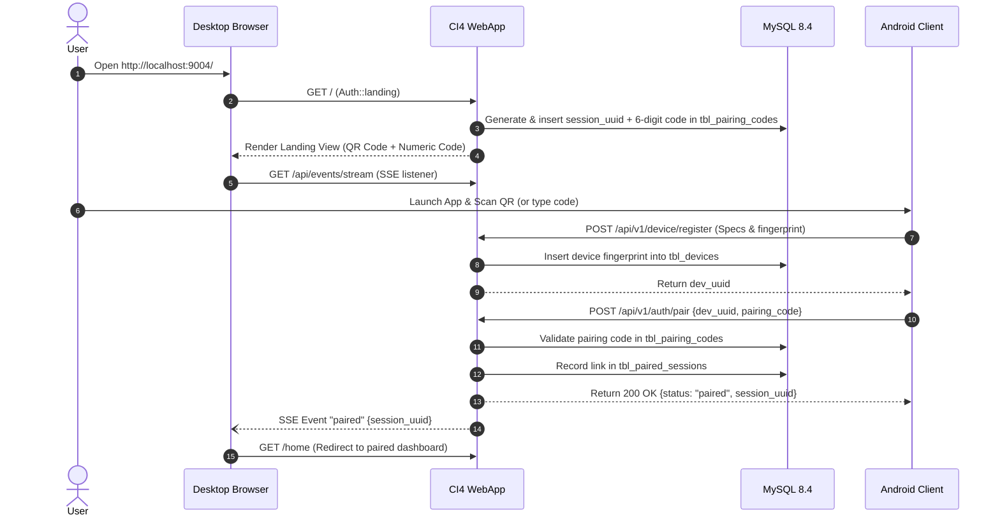
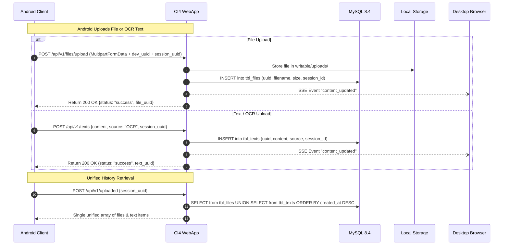
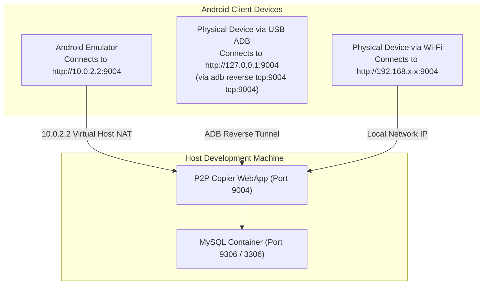

# Communication & Protocol Architecture

This document details inter-service network protocols, authentication handshakes, sequence flows, and event-driven synchronization between the CodeIgniter 4 WebApp and the Android client.

---

## 1. Inter-Service Communication Matrix

| Source | Destination | Protocol / Transport | Auth Mechanism | Base URL (Dev) | Description |
|---|---|---|---|---|---|
| **Web Browser** | CI4 Server | HTTP / HTTPS (JSON & Multipart) | PHP Session Cookie (`session_auth`) | `http://localhost:9004/` | Landing page, file uploads, text submissions, and deletions. |
| **Web Browser** | CI4 Server | Server-Sent Events (SSE) | PHP Session Cookie (`session_auth`) | `http://localhost:9004/api/events/stream` | Real-time event stream alerting browser to new uploads or pairing events. |
| **Android App** | CI4 Server | HTTP / JSON & Multipart | Device UUID (`device_auth`) | `http://10.0.2.2:9004/` (Emulator) `http://192.168.x.x:9004/` (LAN) | Device registration, pairing, unified feed querying, and uploads. |
| **CI4 Server** | MySQL 8.4 | MySQL TCP Protocol | Native MySQL Authentication | `mysql:3306` | Relational query execution via PDO / MySQLi. |

---

## 2. Session Pairing Sequence

Session pairing establishes a secure cryptographic link between the desktop browser session and the Android device.

---

## 3. Data Transfer Sequence (Unified Feed)

---

## 4. Emulator & Local Network Topology

