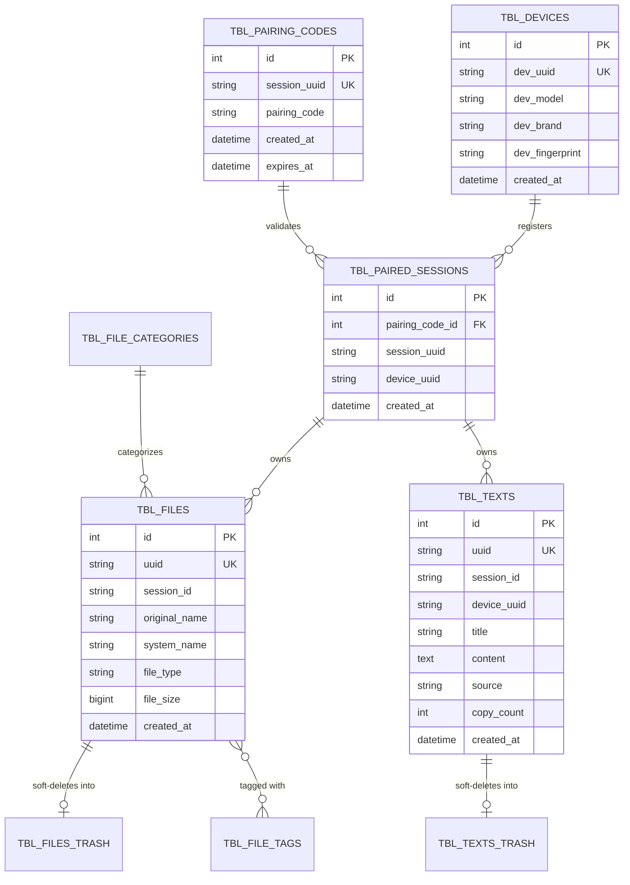

# Data & Storage Architecture

This document catalogs the MySQL 8.4 database schema, Entity-Relationship Diagram (ERD), file storage design, and data lifecycle management in P2P Copier WebApp.

---

## 1. Entity-Relationship Diagram (ERD)

---

## 2. Relational Schema Catalog

Database: `db_p2p_copier` (Engine: InnoDB, Character set: `utf8mb4`, Collation: `utf8mb4_unicode_ci`).

### Primary Tables

| Table Name | Purpose | Key Columns |
|---|---|---|
| `tbl_devices` | Registered Android & client device hardware profiles | `id`, `dev_uuid` (UUID4), `dev_model`, `dev_fingerprint`, `created_at` |
| `tbl_pairing_codes` | Ephemeral pairing codes generated on landing page | `id`, `session_uuid`, `pairing_code` (6 digits), `created_at` |
| `tbl_paired_sessions` | Active association between device UUID and web session | `id`, `pairing_code_id`, `session_uuid`, `device_uuid`, `created_at` |
| `tbl_files` | Active uploaded file metadata | `id`, `uuid`, `session_id`, `original_name`, `system_name`, `file_type`, `file_size`, `created_at` |
| `tbl_files_trash` | Soft-deleted files preserving history | Exact replica of `tbl_files` + `deleted_at`, `deleted_by` |
| `tbl_texts` | Active text notes, camera OCR extractions, QR scans | `id`, `uuid`, `session_id`, `device_uuid`, `title`, `content`, `source`, `copy_count`, `created_at` |
| `tbl_texts_trash` | Soft-deleted text items | Exact replica of `tbl_texts` + `deleted_at`, `deleted_by` |
| `tbl_file_categories` | Categorization buckets (Document, Image, Video, Audio, Archive) | `id`, `name`, `slug`, `icon` |
| `tbl_file_tags` | User and system tags attached to files | `id`, `file_uuid`, `tag_name`, `created_at` |
| `tbl_visitors` | Web browser connection and IP audit trail | `id`, `visitor_ip`, `visitor_user_agent`, `visitor_time` |
| `tbl_device_metrics` | Hardware health telemetry (RAM, battery level, storage) | `id`, `device_uuid`, `battery_pct`, `storage_free_mb`, `created_at` |
| `tbl_security_audit` | Authentication attempts, pairing failures, and rate limits | `id`, `event_type`, `ip_address`, `details`, `created_at` |

---

## 3. Object & Filesystem Storage Architecture

Uploaded binary files are stored in **MinIO S3 Object Storage** (`p2p-copier-files` bucket):
- **Storage Driver**: AWS SDK for PHP (`Aws\S3\S3Client`) wrapped in `App\Libraries\StorageService`.
- **Key Prefixing & Separation**:
  - `active/{uuid}.{ext}`: Active files available for browsing and download.
  - `trash/{uuid}.{ext}`: Soft-deleted files preserved until trash is emptied or permanently deleted.
- **Serving Files**:
  - Direct secure streaming via `Download::browser_file_download($uuid)` and `FilesApi::download`, streaming S3 object bodies directly into HTTP responses.
  - Presigned S3 URLs via `StorageService::getPresignedUrl()` for direct client-to-storage transfers when requested.
- **Storage Quota & Expiration**:
  - Storage quota (500MB per session) checked before upload.
  - Burn-After-Reading (policy `2`) automatically triggers object deletion upon completion of first download.
