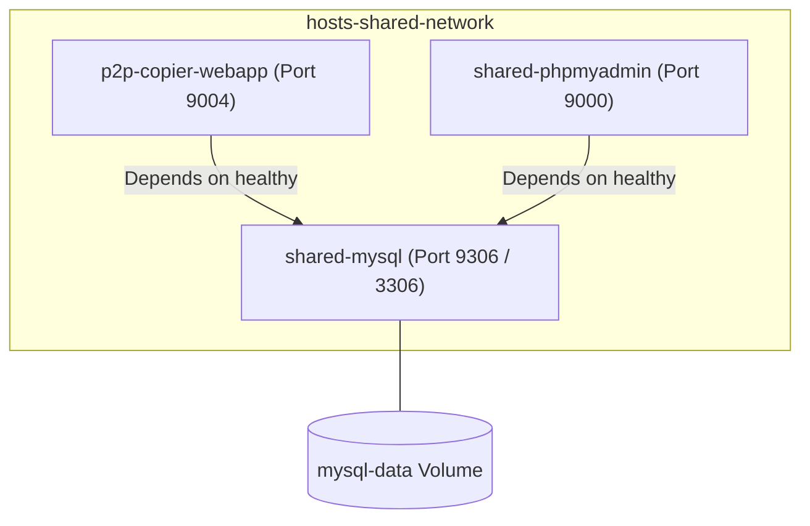

# Deployment & Container Topology

This document details container configuration, deployment orchestration, and volume persistence in P2P Copier WebApp.

---

## 1. Docker Compose Services

The production deployment relies on `docker-compose.yml` comprising three interconnected services:



### Container Details

1. **`p2p-copier-webapp`**:
   - Built from local `Dockerfile` (PHP 8.3 Apache base).
   - Mounts local directory `.:/var/www/html` for live code updates.
   - Entrypoint: executes `entrypoint.sh`, which polls MySQL until healthy, executes `php spark migrate --all`, then launches Apache in the foreground.
2. **`shared-mysql`**:
   - Image: `mysql:8.4`.
   - Healthcheck: `mysqladmin ping -h localhost -u root -proot_password` runs every 10 seconds.
   - Storage volume: `mysql-data` mounted at `/var/lib/mysql`.
3. **`shared-phpmyadmin`**:
   - Image: `phpmyadmin:latest`.
   - Starts after MySQL reaches a healthy state.

---

## 2. Startup Lifecycle (`entrypoint.sh`)

```mermaid
sequenceDiagram
    participant Container as Docker Container
    participant Script as entrypoint.sh
    participant MySQL as MySQL 8.4
    participant CI4 as Spark Migrations
    participant Apache as Apache2 Daemon

    Container->>Script: Run entrypoint.sh on container boot
    loop Wait for MySQL PDO readiness
        Script->>MySQL: new PDO('mysql:host=mysql;port=3306', 'root', 'root_password')
        MySQL-->>Script: Connection accepted
    end
    Script->>CI4: php spark migrate --all
    CI4-->>Script: Migrations executed
    Script->>Apache: exec apache2-foreground
```

---

## 3. Production Deployment Commands

### Start Deployment
```bash
docker compose up --build -d
```

### Inspect Container Logs
```bash
docker compose logs -f p2p-copier
```

### Execute Database Migrations Manually
```bash
docker compose exec p2p-copier php spark migrate
```

### Stop Deployment
```bash
docker compose down
```
