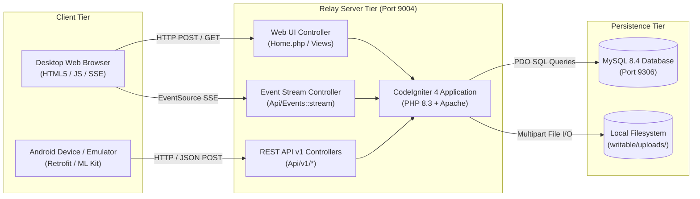
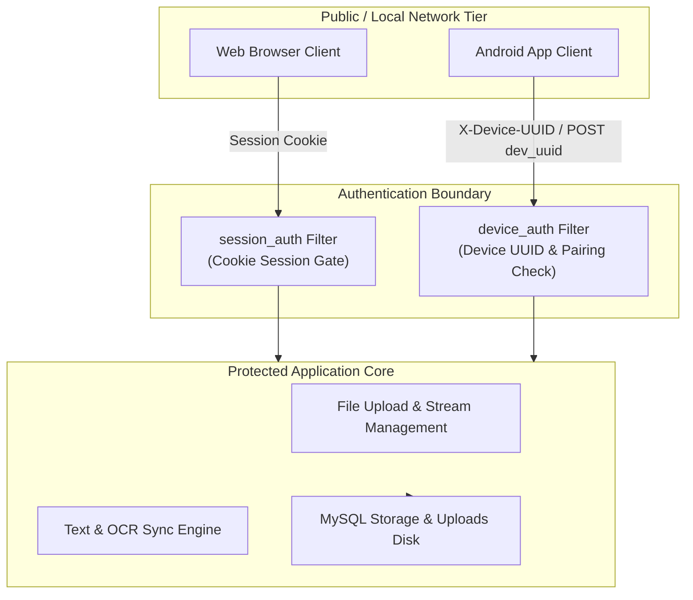

# Architecture Overview

This document describes the high-level system architecture, C4 container model, and trust boundaries of the P2P Copier ecosystem.

---

## 1. System Context & Containers

The P2P Copier system consists of two primary applications: the **CodeIgniter 4 WebApp** (relay server and web interface) and the **Android Native App** client.

---

## 2. Container Inventory & Runtime Mapping

| Container / Component | Repository / Folder | Runtime / Base Image | Published Port | Responsibility |
|---|---|---|---|---|
| `p2p-copier-webapp` | `.` (Root) | PHP 8.3 Apache (`Dockerfile`) | `9004:80` | Serves browser UI, executes REST API endpoints, coordinates session pairing, and serves SSE updates. |
| `shared-mysql` | Volume `mysql-data` | `mysql:8.4` | `9306:3306` | Relational storage for devices, paired sessions, uploaded files metadata, text entries, and audit logs. |
| `shared-phpmyadmin` | External container | `phpmyadmin:latest` | `9000:80` | Web-based database management interface for development and diagnostics. |
| `P2P_Copier_App` | Sibling repo (`P2P_Copier_App`) | Android SDK 24–35 (JVM 11) | N/A (Client) | Mobile client providing on-device ML Kit OCR, ZXing QR scanning, biometrics, and file/text transfers. |

---

## 3. Trust Boundaries & Security Model

1. **Browser Trust Boundary (`session_auth`)**:
   - The desktop browser navigates to `/`, which issues a secure PHP session.
   - Access to `/home`, `/api/events/stream`, and `/saved/*` requires an active session cookie.
2. **Android Trust Boundary (`device_auth`)**:
   - The mobile client registers its hardware fingerprint via `/api/v1/device/register` to acquire a `dev_uuid`.
   - Requests to `/api/v1/*` must submit valid device identity and active pairing tokens verified against `tbl_paired_sessions`.
3. **Data Isolation**:
   - Queries to `tbl_files` and `tbl_texts` are strictly scoped by `session_uuid`. Unpaired devices cannot read or modify another session's data.
